# Chapter 01 - Background ~ A High-level Overview on JVM. ✅

Background ~ A High-level Overview on JVM.

# What I learned.

# Introduction ~ A Brief History of Java & JVM. ✅

    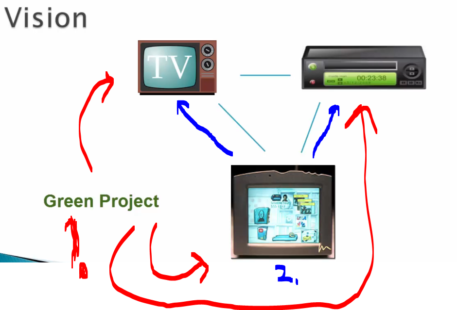

1. Java was designed for **heterogeneous** computing, for the handheld devices!
    - Team was called **Green team**!
2. This device was designed to send **commands** to **TV** and to **recorder**!

- There were **following goals**:

    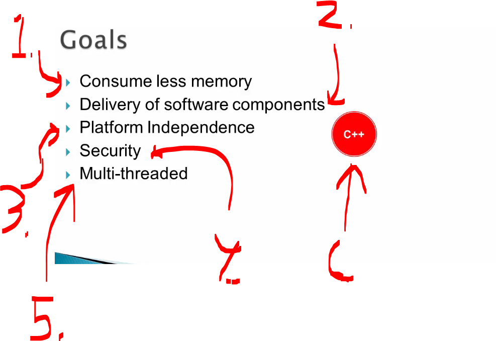

1. Tech needed to be run with less memory!
    - This was targeted to embedded devices!
2. Deploy the software to another devices in the network!
3. The programs should be run regardless of the **platform**!
4. Security was needed!
5. It needed to support **multithreaded** processing.
6. Even **C++** was thought to be used with these solutions!
    - Since it lacked **platform independence**. 

    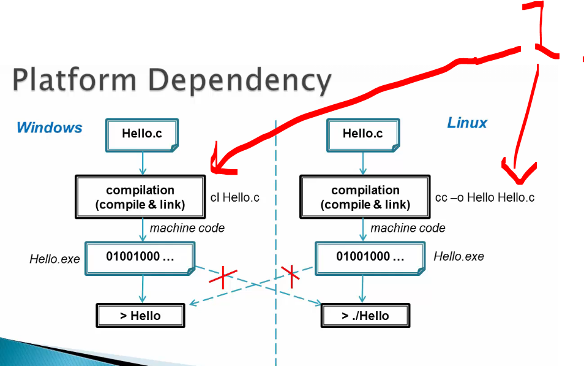

1. For both platforms, the compilation is **independent**, and running these would be impossible to be run in their **own environment**! 

    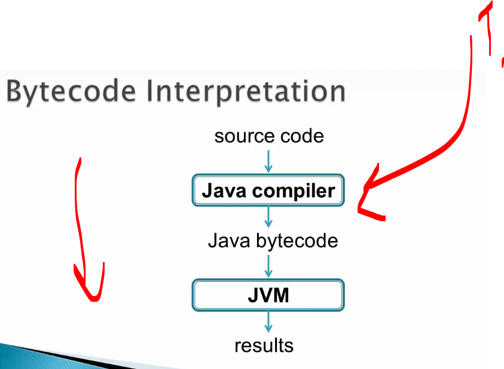

1. Every environment(**Linux** or **Windows**) are going to have own **Java compiler**!

    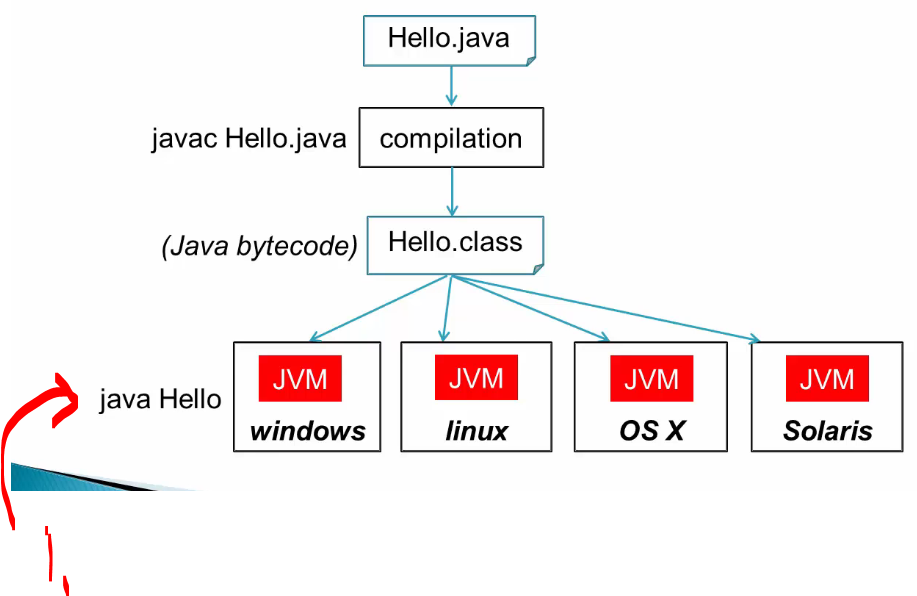

1. We can see that in **every platform** has their own **JVM implementation**! 

    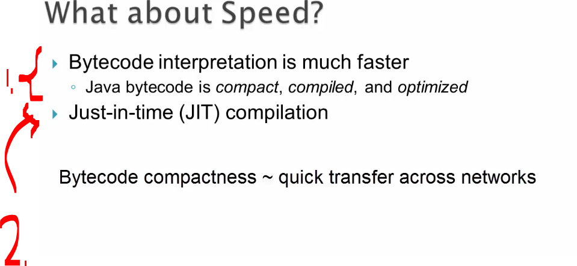

1. The speed comes from the byte code that is optimized! 
2. **JIT** is also providing the speed for the combination!

# Java Virtual Machine ~ A High-level Overview.

    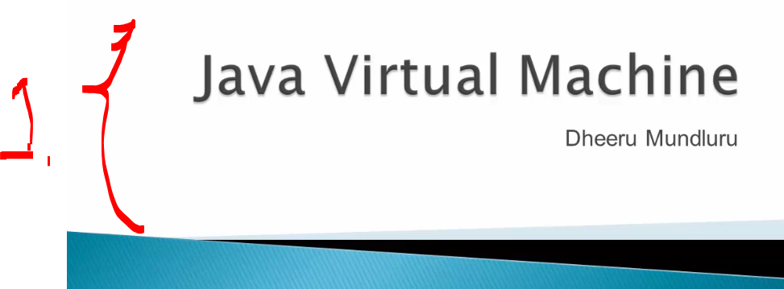

1. JVM is well optimized and tested!

    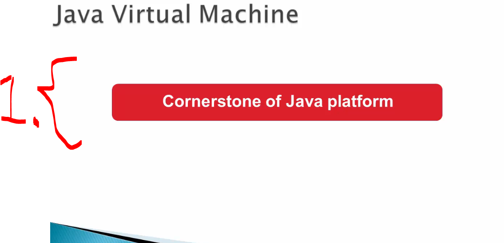

1. JVM is cornerstone of the Java platform!
    - The speed comes from the byte code that is optimized! 

    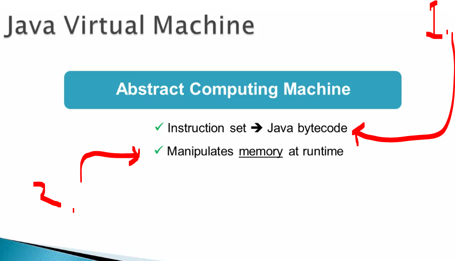

1. It's called *Virtaul*, since its **abstract computing machine**!
    - It has its own **Instruction set**!
2. JVM manipulates memory at runtime!

    

1. Running and reading bytecode!
2. Executing code **securely**!
3. No need manage the memory automatically! Like in C and C++!

    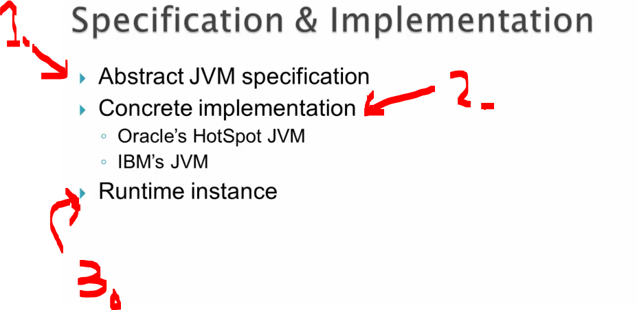

1. **JVM** has specification.
    - Anyone can implement their own **Java Virtual Machine**!
    - Java has its own specification! **JLS**!
    - [Specs](https://docs.oracle.com/javase/specs/index.html)!
2. Couple JVM is implemented: 
    - Oracle's.
    - IBM's.
3. Runtime instance!

    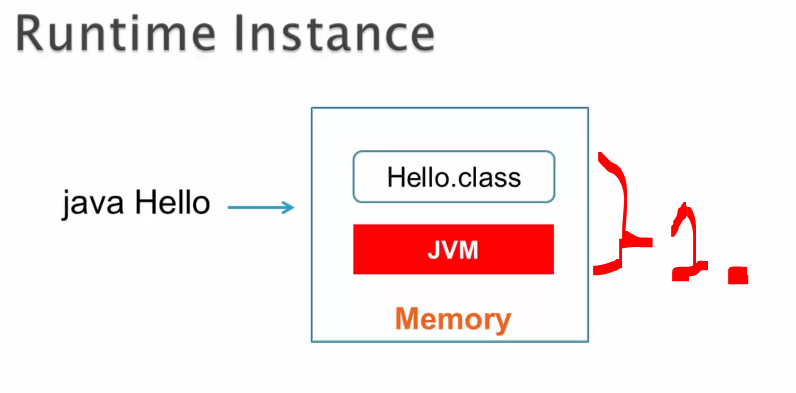

1. Both `Hello.class` and **JVM** is loaded into memory.
    - The `Hello.class` is loaded into **JVM runtime instance**! 

    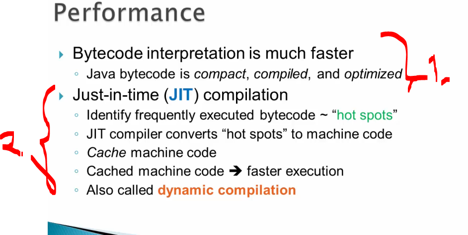

1.
2. **JVM defects** and **measures** the most frequent codes!
    - These are called *hot spots*, these spots are converted by the **JIT** to machine code!
        - This may be cached!
    - The `dynamic compilation` done by the vendors to be implemented!  

# UI Controls for Site Navigation & Copyright Details.