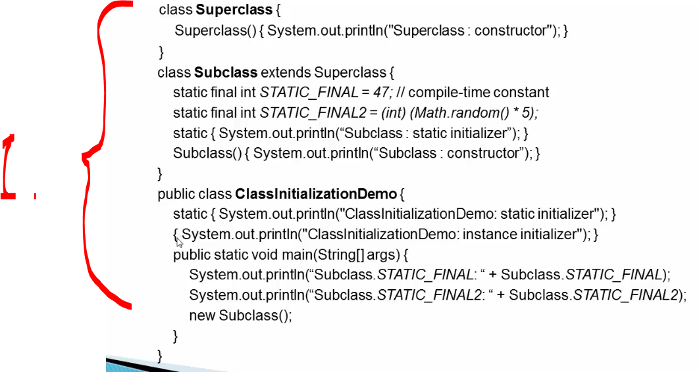
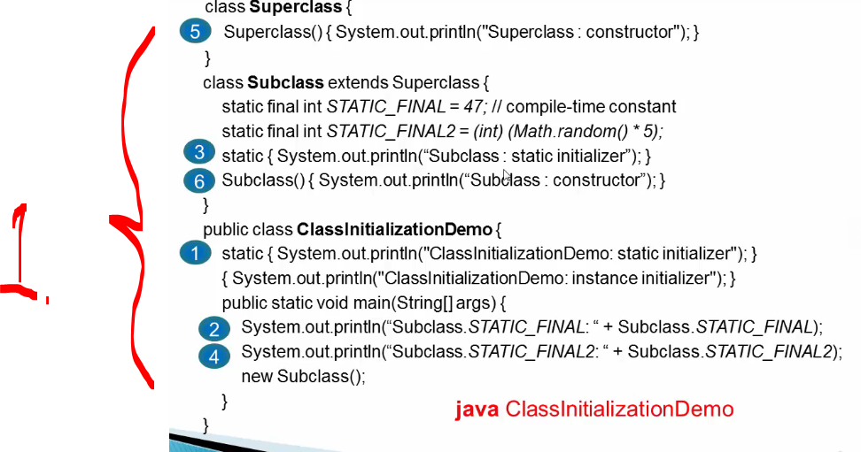
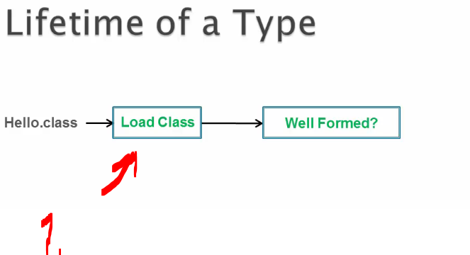
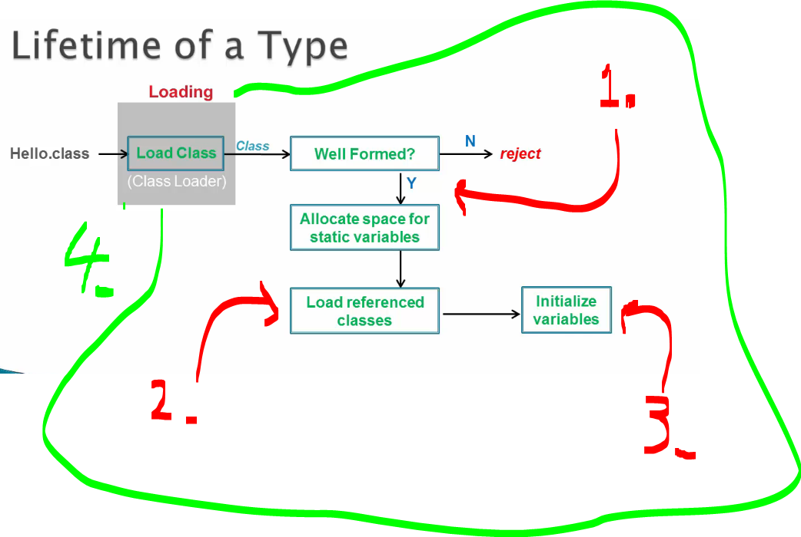
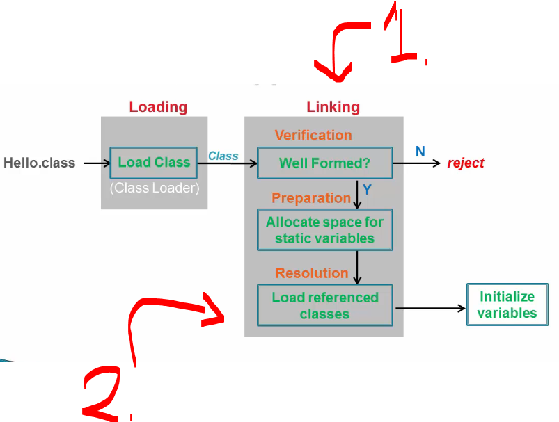

# Chapter 02 - Introduction.

Introduction.

# What I learned.

# Lifetime of a Type: Motivation.

<div 
align="center">
    
</div>

1. We will be looking for the:
    - Why we are looking lifetime?
    - For different types!

<div 
align="center">
    
</div>

1. We will be looking how this **lifetime** for this **particular class** is getting initialized!
    - `java ClassInitializationDemo` would be executed!

- We have the **code** for this **slide**:
    ````Java
    class Superclass {
        Superclass() { System.out.println("Superclass : constructor"); }
    }

    class Subclass extends Superclass {
        static final int STATIC_FINAL = 47; // compile-time constant
        static final int STATIC_FINAL2 = (int) (Math.random() * 5);
        static { System.out.println("Subclass : static initializer"); }
        Subclass() { System.out.println("Subclass : constructor"); }
    }

    public class ClassInitializationDemo {
        static { System.out.println("ClassInitializationDemo: static initializer"); }
        { System.out.println("ClassInitializationDemo: instance initializer"); }
        
        public static void main(String[] args) {
            System.out.println("Subclass.STATIC_FINAL: " + Subclass.STATIC_FINAL);
            System.out.println("Subclass.STATIC_FINAL2: " + Subclass.STATIC_FINAL2);
            new Subclass();
        }
    }
    ````
<div 
align="center">
    
</div>

1. We will be looking into the order of the loading.
    - This will be looked at one at the time!

# An Overview of Lifetime of a Type within JVM.

<div 
align="center">
    
</div>

1. `Hello.class` is loaded into memory using the **Class Loader**!
    - It checks if it follows the **Well Formed** standard!
        - The code could be compiled by malicious compiler, there is extra step!  

<div 
align="center">
    
</div>

1. If byte code check is fine, it will have **allocated space** for static variables!
    - Those are initialized with the **default values**!
2. The class is getting files/classes loaded, which are **referred** from this `Hello.java` class!
3. Final step is to **initialize variables**, from those default values!
4. This **whole process** is called `Loading` and its done by the **Class Loader**!
    - **Class Loader** will go looking for the `.class` from the **classpath**!
        - If it's found, it will load that bytecode into memory!
            - In the end of it will be creating **Class Object**. 

> [!NOTE]
> 📝 `.class` -file is inside your local hard drive.
> 
> **Class -object** is created, when **Class Loader** is loading the `.class` file into the **JVM**. 📝 

<div 
align="center">
    
</div>

1. Next step after `Loading` is `Linking`!
    - First step is the **Verification**!
    - Second step is the **Preparation**!
    - Third step is the **Resolution**!
2. This **third** step is called `Dynamic Linking`, since it's done in runtime!


- Do the initailization step


# Class Loading.

# Linking.

# Short Note on Resolution Step for Better Clarity.

# Demo: Lifetime of a Type.

# Quiz: Chapter Quiz.

# Important Q&A Discussions!
