# Chapter 02 - Introduction. ✅

Introduction.

# What I learned.

# Lifetime of a Type: Motivation. ✅

<div 
align="center">
    
</div>

1. We will be looking for the:
    - Why we are looking lifetime?
    - For different types to be loaded!

<div 
align="center">
    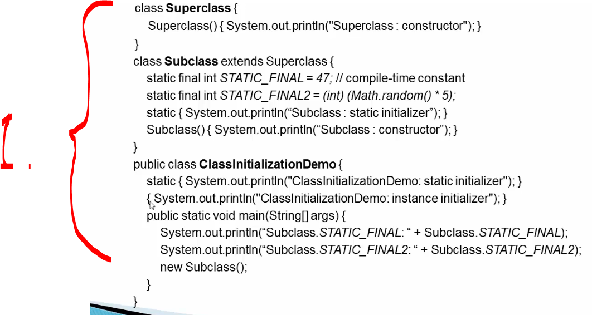
</div>

1. We will be looking how this **lifetime** for this **particular class** is getting initialized!
    - `java ClassInitializationDemo` would be executed!

- We have the **code** for this **slide**:
    ````Java
    class Superclass {
        Superclass() { System.out.println("Superclass : constructor"); }
    }

    class Subclass extends Superclass {
        static final int STATIC_FINAL = 47; // compile-time constant
        static final int STATIC_FINAL2 = (int) (Math.random() * 5);
        static { System.out.println("Subclass : static initializer"); }
        Subclass() { System.out.println("Subclass : constructor"); }
    }

    public class ClassInitializationDemo {
        static { System.out.println("ClassInitializationDemo: static initializer"); }
        { System.out.println("ClassInitializationDemo: instance initializer"); }
        
        public static void main(String[] args) {
            System.out.println("Subclass.STATIC_FINAL: " + Subclass.STATIC_FINAL);
            System.out.println("Subclass.STATIC_FINAL2: " + Subclass.STATIC_FINAL2);
            new Subclass();
        }
    }
    ````
<div 
align="center">
    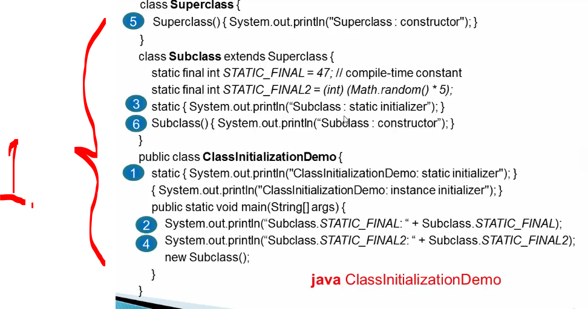
</div>

1. We will be looking into the order of the loading.
    - This will be looked at one at the time!

# An Overview of Lifetime of a Type within JVM. ✅

<div 
align="center">
    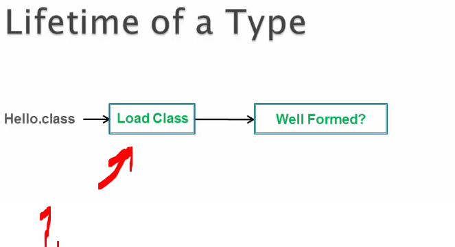
</div>

1. `Hello.class` is loaded into memory using the **Class Loader**!
    - It checks if it follows the **Well Formed** standard!
        - The code could be compiled by malicious compiler, there is extra step!  

<div 
align="center">
    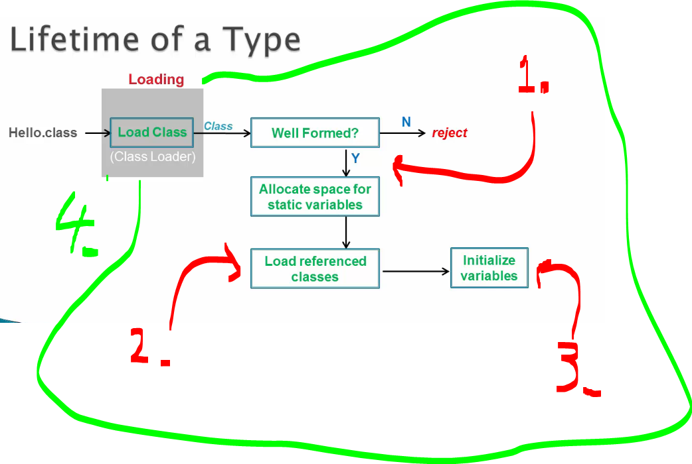
</div>

1. If byte code check is fine, it will have **allocated space** for static variables!
    - Those are initialized with the **default values**!
2. The class is getting files/classes loaded, which are **referred** from this `Hello.java` class!
3. Final step is to **initialize variables**, from those default values!
4. This **whole process** is called `Loading` and its done by the **Class Loader**!
    - **Class Loader** will go looking for the `.class` from the **classpath**!
        - If it's found, it will load that bytecode into memory!
            - In the end of it will be creating **Class Object**. 

> [!NOTE]
> 📝 `.class` -file is inside your local hard drive.
> 
> **Class -object** is created, when **Class Loader** is loading the `.class` file into the **JVM**. 📝 

<div 
align="center">
    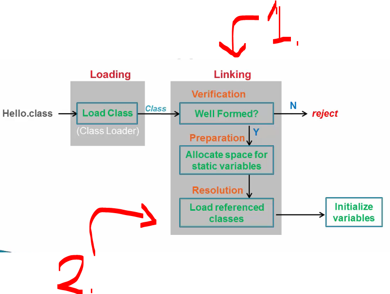
</div>

1. Next step after `Loading` is `Linking`!
    - First step is the **Verification**!
    - Second step is the **Preparation**!
    - Third step is the **Resolution**!
2. This **third** step is called `Dynamic Linking`, since it's done in runtime!

<div 
align="center">
    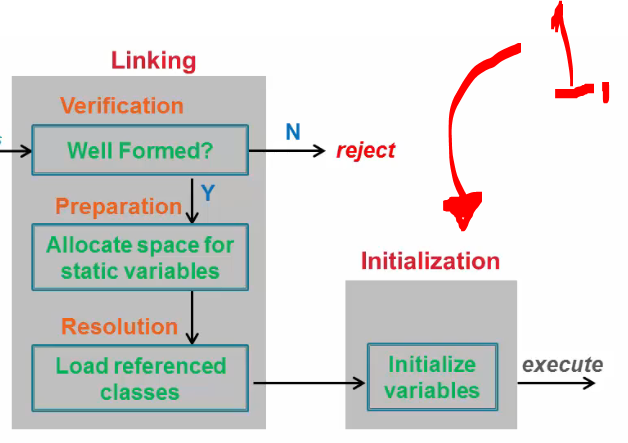
</div>

1. Initialization step is going initialize the default values, with the user defined values! 

> [!NOTE]
> 📝 Before a class is initialized, its superclass must be initialized first. 📝 

- An interface is initialized when one of its initialization-triggering actions occurs.

- todo check this one, for different interfaces checks.

# Class Loading.

<div 
align="center">
    
</div>

1. Let's explore the **Class Loading** in more detail!

<div 
align="center">
    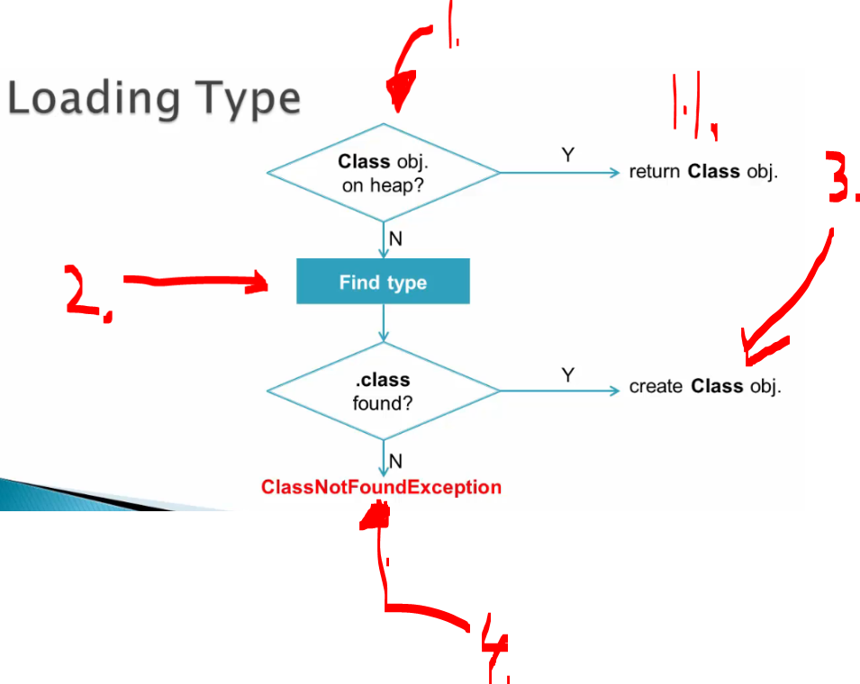
</div>

1. If the **class** or the **interface** is loaded, it is being checked if its already on the **heap** at point `1.1`!
    - If it is on the heap, the **class object** returns from the heap!    
2. If it's **not found** in the **heap**, it is used to find the **Parent Delegation Model** to find `.class`!
3. The **Class** `obj.` will be created in the **JVM's memory**, heap. 
    - A raw file on a disk cannot be used directly by Java code;
4. If the `.class` have not been found, the `ClassNotFoundException` is **thrown**!

<div 
align="center">
    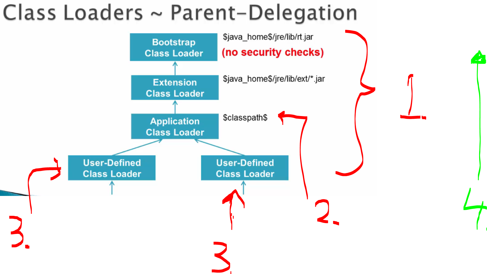
</div>

1. Java multiple repositories for loading classes
2. **Application Class Loader** is to load classes, which the developer **usually develop**!
3. We can load **Custom Class Loaders** which are defined by the developers!
4. The Delegation (**Bottom to Top**): Instead of looking at its own files, that bottom loader immediately delegates the task upward to its parent, which delegates to its parent, all the way up to the Bootstrap **ClassLoader** at the top.

<div 
align="center">
    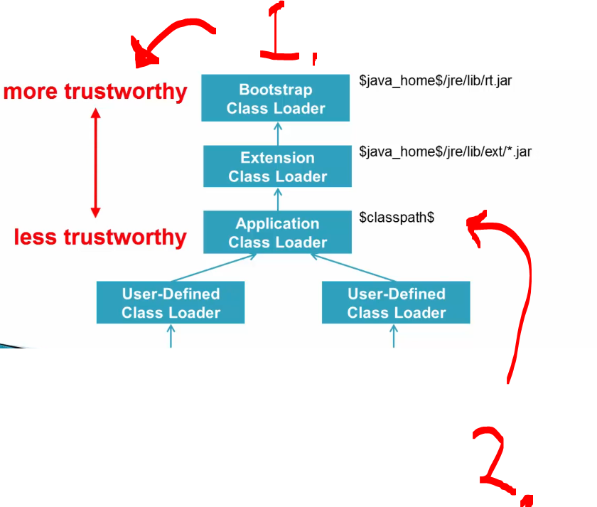
</div>

1. From **JVM** perspective the **upper level** repositories are **more trustworthy**, than the **lower ones**!
    - This affects to the security checks that are performed later!
        - These are **Java's** official libraries that have been **already checked** and **defined libraries**!
<div 
align="center">
    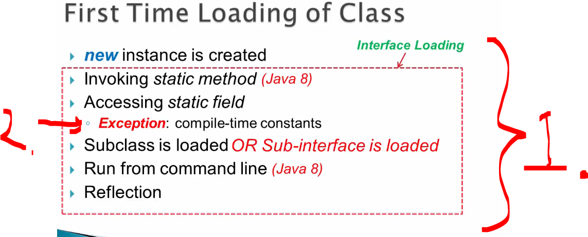
</div>

1. **Classes are loaded** when in following cases:
    - When there is `new` **instance** is created!
    - Invoking the **static method**!
    - **Accessing static** fields!
        - **Exceptions** are the **compile-time** constant!
    - **Subclass** is loaded!
    - Classes are loaded when they **run** from the command line!
    - Classes are loaded from the **reflection**!

- TODO check the interace things!

<div 
align="center">
    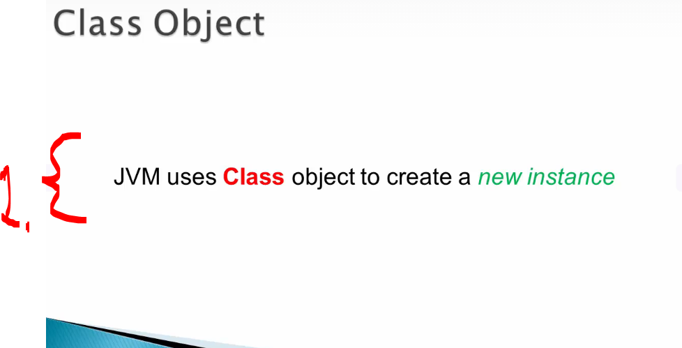
</div>

1.  **Notice** JVM uses **Class** object
    - After loading the `.class`, the **JVM** uses the **class objects** to create new instances! 

<div 
align="center">
    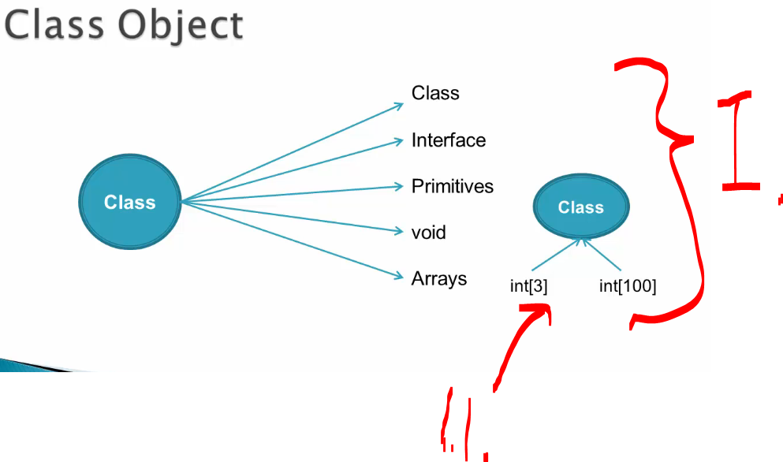
</div>

1. These types are going to have their own `.class`!
    - Classes (`class`).
    - Interfaces (`interface`, including annotation types).
    - Primitive Types (`int`, `double`, `boolean`, `char`, etc.).
    - The `void` pseudo-type (representing the absence of a return value).
    - Array Types (`int[]`, `String[][]`, etc.). The same array dimension will have the same `.class` file in the `1.1`!
        - `int[3]` and `int[100]` will have the **same dimension** and **type**! 

<div 
align="center">
    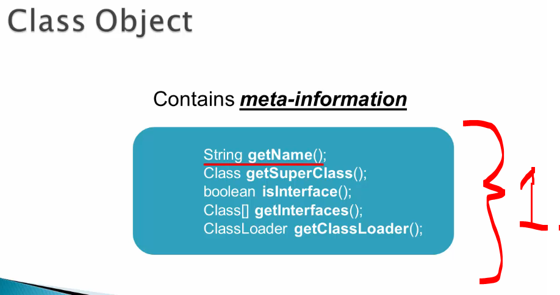
</div>

1. The methods for getting **meta** information:
    - `String getName();` – Returns the **class name**.
    - `Class getSuperClass();` – Returns `null` if the represented type is:
        - Or the superclass of the type
            - `null` is **returned** if the **Object class**, **interface**, **primitive** or **void** type. 
            - **Object** is returned when it's getting from the array class.
    - `boolean isInterface();` – **Checks** whether it **is an interface**.
    - `Class[] getInterfaces();` – Returns the **interfaces implemented by the class**.
    - `ClassLoader getClassLoader();` – Returns **the class loader** that **loaded the class**.

<div 
align="center">
    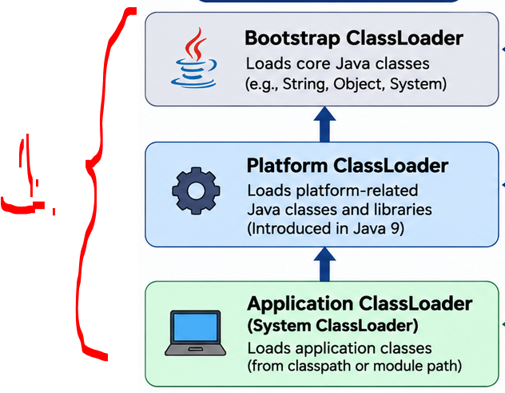
</div>

1. There is 3 main **ClassLoaders**
    - **Bootstrap** ClassLoader!
    - **Platform** ClassLoader!
    - **Application** ClassLoader!


# Linking. ✅

<div 
align="center">
    
</div>

1. Let's check the linking step!

- There are three linking steps:

<div 
align="center">
    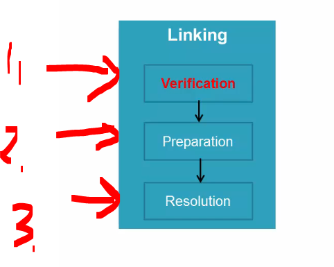
</div>

1. Verification!
    - The check if the rules are being met!
        - This is to check the if the **JVM** is compiled with the **right standards**!
    <div 
    align="center">
        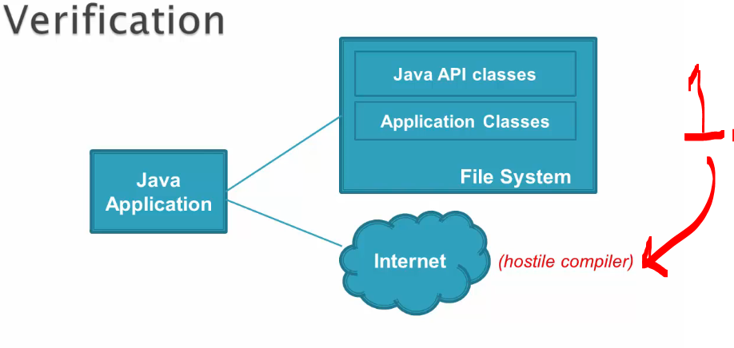
    </div>
    1. There can be <b>hostile compilers</b>, which can have been compiled with <b>malicious code</b>! <br> <b>Notice</b> that the libraries are <b>not verified</b> from the <b>Bootstrap ClassLoader</b>, since those are provided by the Oracle!
    <div 
    align="center">
        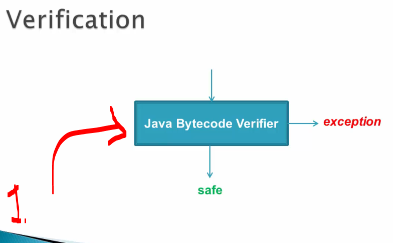
    </div>
    1. The <b>Java Code Verifier</b> (Bytecode Verifier) is a component of the JVM that checks whether compiled Java bytecode is valid and safe before execution.
    <div 
    align="center">
        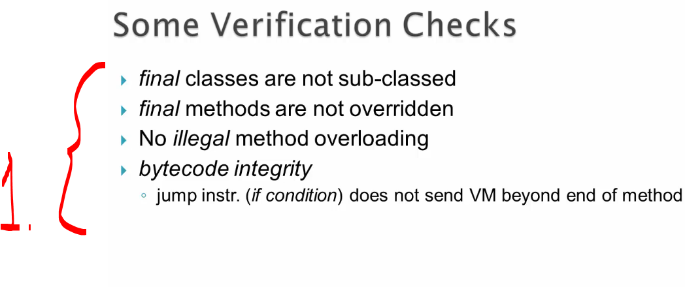
    </div>
    1. Java combiler checks the <b>Java Source code</b>, while the <b>Bytecode Verifier</b> chekcs the <b>generated bytecode</b>!
2. Preparation!
    <div 
    align="center">
        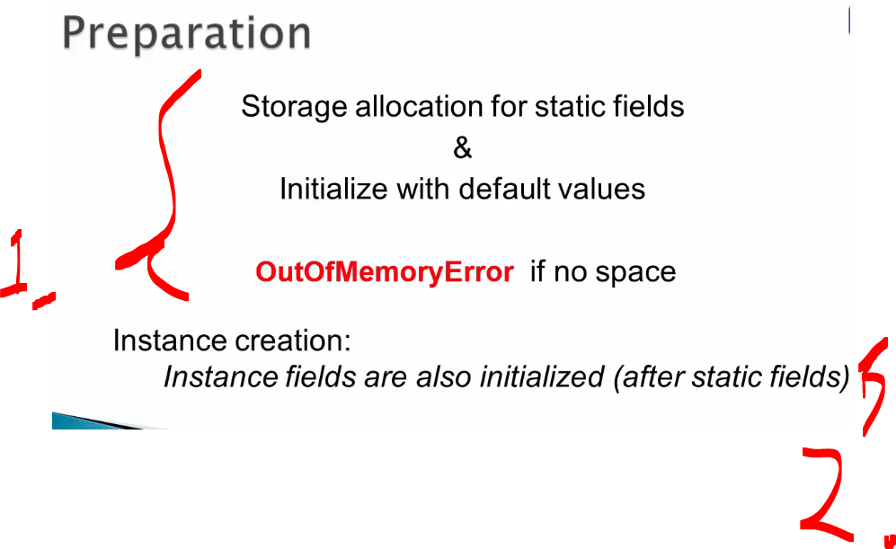
    </div>
    1. Space is allocated for the static fields! The `OutOfMemoryError` is thrown if there is no space!
    2. Only after the <b>static</b> todo
3. Resolution!
<div 
    align="center">
        
    </div>


# Short Note on Resolution Step for Better Clarity.

# Demo: Lifetime of a Type.

# Quiz 01: Chapter Quiz.

# Important Q&A Discussions!
