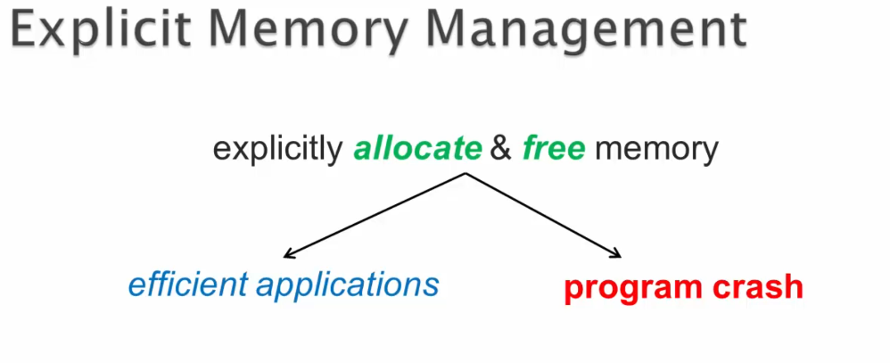

# Chapter 04 - JVM Memory, Garbage Collection, and Bytecode Instructions. ✅

JVM Memory, Garbage Collection, and Bytecode Instructions.

# What I learned.

# Garbage Collection: Introduction. ✅

    

1. Did you know **heap memory**, is holding `Objects`? These are controlled by garbage collection!

    

Explicit Memory Management

    The core action is to explicitly allocate & free memory.

Two Divergent Paths:

    Efficient applications: This is the result of successful management.

    Program crash: This is the result of management failure.

# Introduction to Runtime Data Areas of JVM. ✅

# Method Area & Heap. ✅

# Method Table ~ Achieving Dynamic Method Dispatching. ✅

# Garbage Collection: Introduction. ✅

# JVM's Garbage Collection Algorithms. ✅

# GC: Generational Collections. ✅

# Demo: Tuning JVM Heap & Analyzing GC Cycles. ✅

# Item 06: Eliminate Obsolete Object References. ✅

# Stack. ✅

# Stack Frame. ✅

# Instruction Set: invokespecial & invokevirtual + Demo. ✅

# Quiz 02: Chapter Quiz. ✅

# Important Q&A Discussions! ✅ 