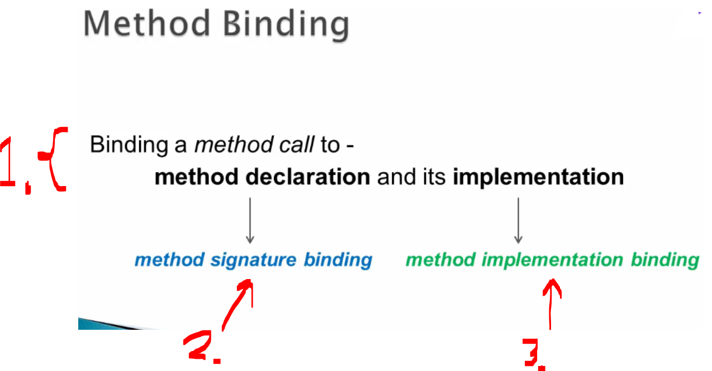
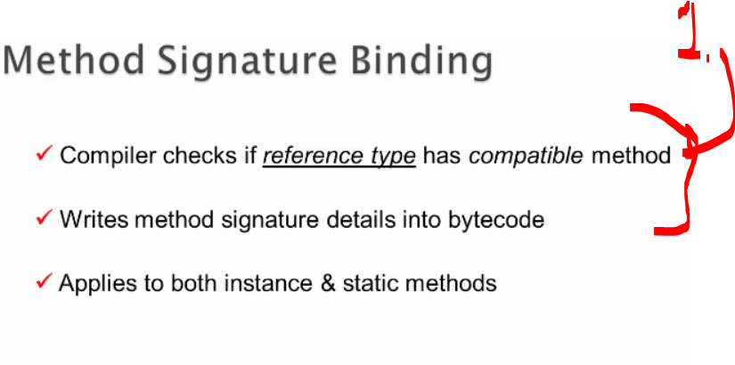
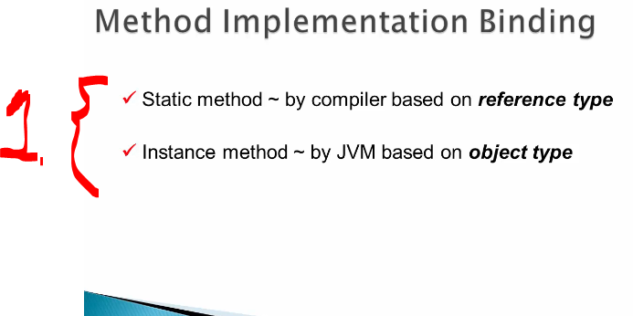
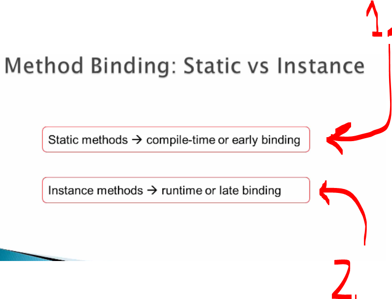
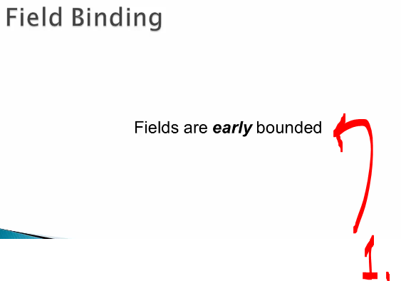

# Chapter 06 - Bonus Chapter. ✅

Bonus Chapter.

# What I learned.

# Method Binding + Demo. ✅

        

1. We will be checking method binding!

        

1. **Method Binding** is act of binding the method **implementation** to the method **definition**!
2. **Method declaration** is called **method signature binding**! 
3. The **implementation** is called **method implementation binding**!

        

**Compiler verifies** whether the reference type contains or inherits a method declaration that matches the name and parameter types you are trying to call and writes to byte that to byte code!

- Example of the **reference type** and **object type**: `Animal myPet = new Dog();`.
    - **Reference Type**: `Animal`.
    - Runtime **Object Type**: `Dog`.

        

1. Depending on the **type of method**, implementation binding happens in one of **two places**:
    - At Compile Time (by the **Compiler**).
        - If the **method is the static**!
    - At Runtime (by the **JVM**).
        - If the method is **instance method**!

        

1. **Early Binding** (Compile-Time Binding): Applied to static methods. It's called "early" because the compiler locks in the exact method implementation before the program ever runs
2. **Late Binding**/**Runtime Binding**: Applied to instance methods. It's called "late" because the binding is delayed until the program is running, allowing the JVM to look at the actual object in memory and decide which method version to invoke. 

        

1. **Instance Fields** are **early blinded**.
    - While, **Instance Methods** use **late binding** (also known as runtime binding or dynamic binding)!

- We are using the **Java Disassembler** called `javap`!
    - One can check the [documentation](https://docs.oracle.com/en/java/javase/21/docs/specs/man/javap.html) link!

# Websites & Social Media Groups to Follow. ✅
